# Instalación y configuración de Dolibarr


Franco Naraza

## Introducción:

En esta práctica se realiza la instalación y configuración de Dolibarr en un servidor Ubuntu que ya dispone de WordPress, Apache, PHP y MariaDB. El objetivo es conseguir que ambas aplicaciones funcionen simultáneamente en el mismo servidor, manteniendo sus configuraciones y bases de datos separadas. Durante el proceso también se comprueban los requisitos necesarios, se solucionan los problemas encontrados y se verifica el funcionamiento final de las dos aplicaciones.

---


## 1. Conexión al servidor mediante SSH

Para realizar la instalación y configuración de Dolibarr se accederá al servidor Ubuntu mediante SSH desde el equipo cliente. Esto permite administrar el servidor de forma remota mediante la terminal.

```bash
ssh francoadmin@10.0.9.145
```

Una vez introducida la contraseña del usuario del servidor, se mostrará el terminal correspondiente al servidor Ubuntu.

<p align="center">
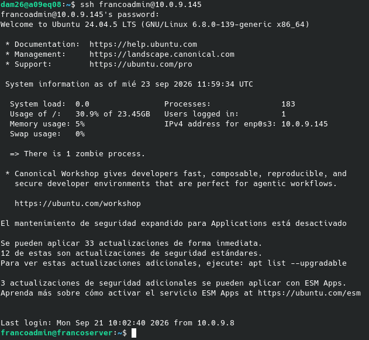
<br>
<em>Conexión al servidor Ubuntu mediante SSH.</em>
</p>

---

## 2. Comprobación de las versiones instaladas

Antes de instalar Dolibarr se comprueban las versiones de los principales componentes de la pila LAMP.

```bash
php -v
mariadb --version
apache2 -v
```

Se debe mostrar la versión instalada de PHP, MariaDB y Apache.

<p align="center">
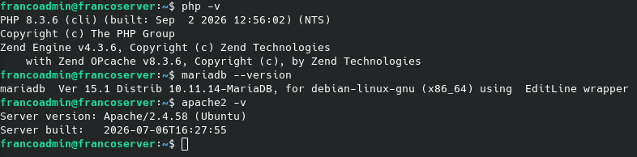
<br>
<em>Comprobación de las versiones de PHP, MariaDB y Apache.</em>
</p>

---

## 3. Comprobación del estado de Apache y MariaDB

Se comprueba que los servicios necesarios para ejecutar las aplicaciones web están activos.

```bash
sudo systemctl status apache2
sudo systemctl status mariadb
```

En ambos casos se espera encontrar:

```text
Active: active (running)
```

<p align="center">
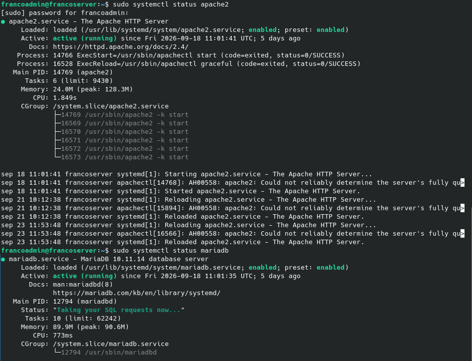
<br>
<em>Comprobación del estado de los servicios Apache y MariaDB.</em>
</p>

---

## 4. Comprobación de WordPress

Antes de realizar cambios en el servidor se comprueba que la instalación existente de WordPress continúa funcionando correctamente.

Se accede desde el navegador a:

```text
http://10.0.9.145
```

La página de WordPress debe cargarse correctamente.

<p align="center">
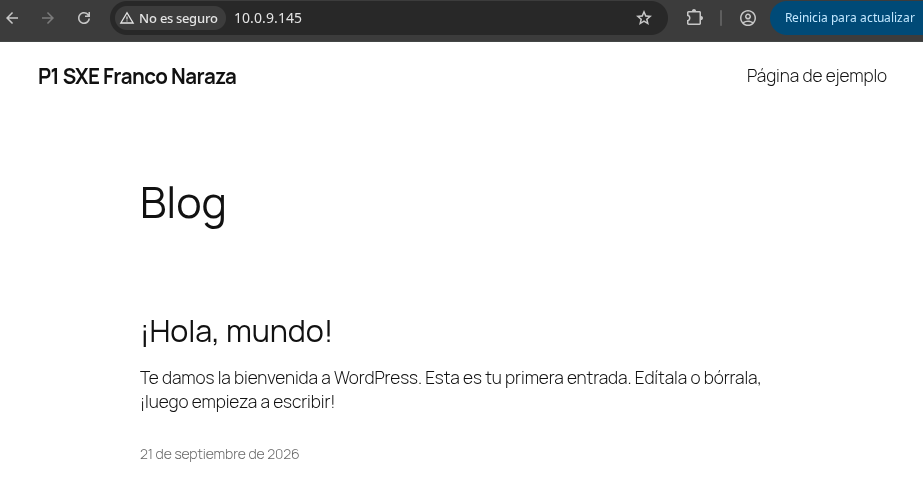
<br>
<em>Comprobación del funcionamiento de WordPress antes de instalar Dolibarr.</em>
</p>

---

## 5. Descarga de Dolibarr

Se descarga el paquete de Dolibarr dentro del directorio `/srv/www`, donde se encuentran los archivos de las aplicaciones web del servidor.

```bash
cd /srv/www
sudo wget https://www.dolibarr.org/files/stable/standard/dolibarr-24.0.1.tgz
```

El comando `wget` descarga el archivo comprimido de Dolibarr desde su servidor oficial.

<p align="center">
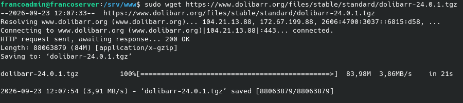
<br>
<em>Descarga del paquete de instalación de Dolibarr en <code>/srv/www</code>.</em>
</p>

---

## 6. Descompresión y comprobación de Dolibarr

Se descomprime el archivo descargado y se comprueba que los archivos de Dolibarr se han creado correctamente.

```bash
sudo tar -xzf dolibarr-24.0.1.tgz
ls -l
```

Después se organiza la instalación utilizando el directorio `/srv/www/dolibarr`. Dentro de este directorio se encuentra la estructura necesaria para la aplicación, incluyendo `htdocs`.

<p align="center">
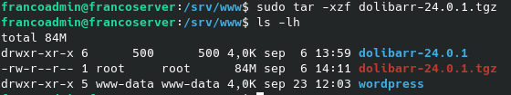
<br>
<em>Descompresión y comprobación de los archivos de Dolibarr.</em>
</p>

---

## 7. Asignación de permisos y organización de Dolibarr

Para que Apache pueda acceder correctamente a los archivos de Dolibarr, se establece como propietario al usuario y grupo utilizados por el servidor web.

```bash
sudo chown -R www-data:www-data /srv/www/dolibarr
```

De esta forma, los archivos quedan preparados para ser utilizados por Apache.

<p align="center">
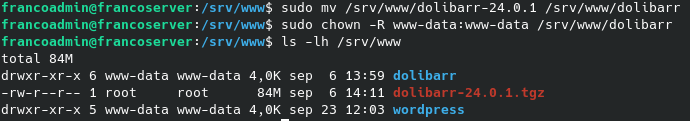
<br>
<em>Configuración de la ubicación y permisos de los archivos de Dolibarr.</em>
</p>

---

## 8. Creación de la base de datos y usuario de Dolibarr

Para mantener separadas las dos aplicaciones, se crea una base de datos y un usuario específico para Dolibarr en MariaDB. De esta forma, Dolibarr no utiliza la base de datos de WordPress.

Se accede a MariaDB:

```bash
sudo mariadb
```

Y se ejecutan las siguientes instrucciones:

```sql
CREATE DATABASE dolibarr DEFAULT CHARACTER SET utf8mb4 COLLATE utf8mb4_unicode_ci;
CREATE USER 'dolibarr'@'localhost' IDENTIFIED BY 'CONTRASEÑA';
GRANT ALL PRIVILEGES ON dolibarr.* TO 'dolibarr'@'localhost';
FLUSH PRIVILEGES;
exit;
```

`CONTRASEÑA` representa una contraseña definida durante la instalación y no debe aparecer en el manual ni en las capturas.

<p align="center">
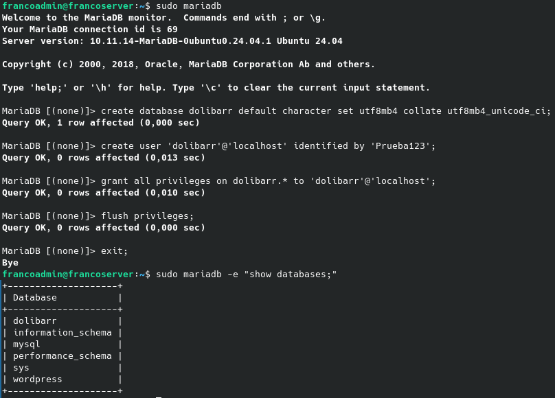
<br>
<em>Creación de la base de datos y del usuario independiente de Dolibarr.</em>
</p>

---

## 9. Creación de la configuración de Apache

Para permitir que Dolibarr y WordPress funcionen simultáneamente en el mismo servidor se crea una configuración independiente de Apache para Dolibarr.

```bash
sudo nano /etc/apache2/sites-available/dolibarr.conf
```

La configuración utiliza un `Alias` para acceder a Dolibarr mediante `/dolibarr`, manteniendo WordPress en la dirección principal:

```apache
Alias /dolibarr /srv/www/dolibarr/htdocs

<Directory /srv/www/dolibarr/htdocs>
    Options FollowSymLinks
    AllowOverride All
    Require all granted
</Directory>
```

De esta manera:

```text
http://10.0.9.145          → WordPress
http://10.0.9.145/dolibarr → Dolibarr
```

<p align="center">
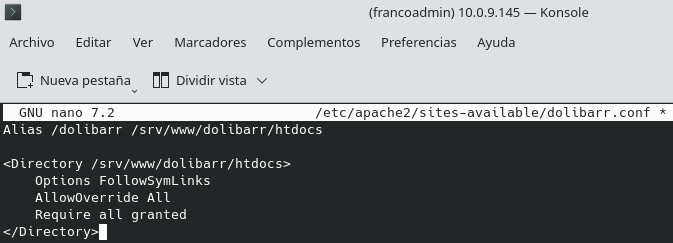
<br>
<em>Configuración de Apache para permitir el acceso a Dolibarr mediante <code>/dolibarr</code>.</em>
</p>

---

## 10. Activación de la configuración de Apache

Una vez creada la configuración, se activa el sitio y se recarga Apache para aplicar los cambios.

```bash
sudo a2ensite dolibarr.conf
sudo systemctl reload apache2
```

También se puede comprobar previamente la configuración con:

```bash
sudo apache2ctl configtest
```

El resultado esperado es:

```text
Syntax OK
```

<p align="center">
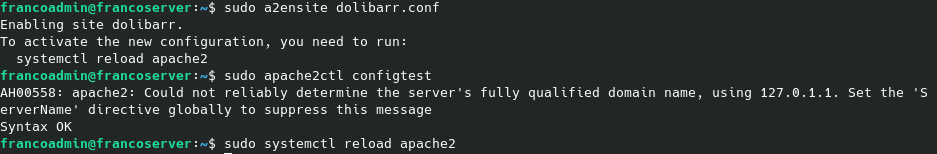
<br>
<em>Activación de la configuración de Dolibarr y recarga de Apache.</em>
</p>

---

## 11. Acceso al instalador de Dolibarr

Con Apache configurado, se accede desde el navegador a:

```text
http://10.0.9.145/dolibarr
```

Se muestra la pantalla inicial del instalador de Dolibarr, desde la que comienza el proceso de configuración.

<p align="center">
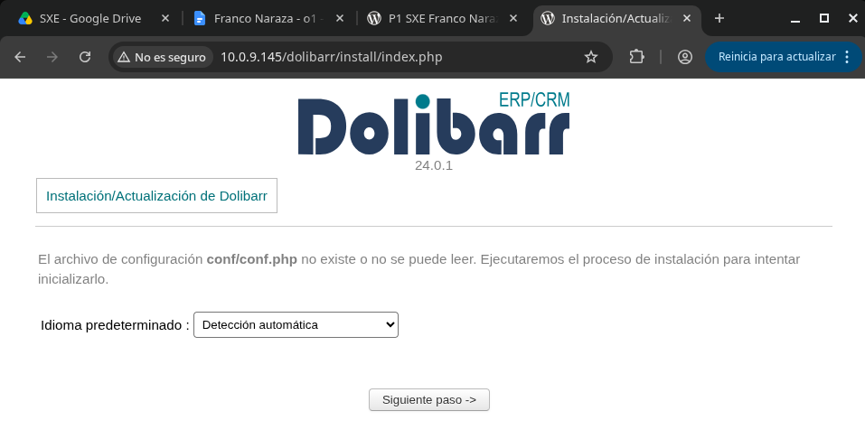
<br>
<em>Pantalla inicial del instalador web de Dolibarr.</em>
</p>

---

## 12. Comprobación de prerrequisitos

Dolibarr realiza una comprobación automática de los requisitos necesarios para la instalación.

Durante esta comprobación se detecta que la instalación de PHP no dispone de las funciones **GD**, por lo que aparece un aviso indicando que dichas funciones no están disponibles.

<p align="center">
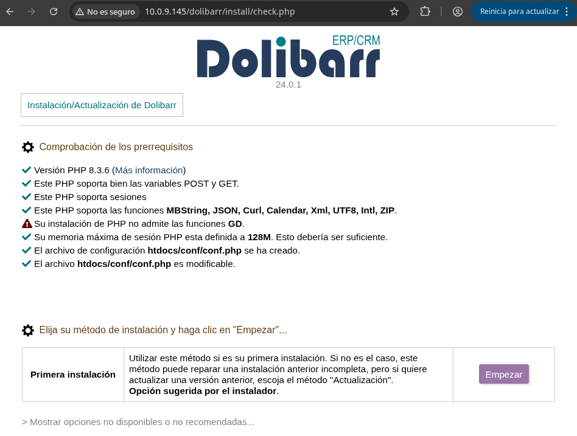
<br>
<em>Comprobación de prerrequisitos de Dolibarr y detección de la ausencia de GD.</em>
</p>

---

## 13. Instalación de la extensión GD

Para solucionar el requisito anterior se instala la extensión GD para PHP:

```bash
sudo apt install php-gd -y
```

Después se reinicia Apache para que PHP cargue la nueva extensión:

```bash
sudo systemctl restart apache2
```

Finalmente se puede comprobar que GD está disponible mediante:

```bash
php -m | grep gd
```

El resultado esperado es:

```text
gd
```

<p align="center">
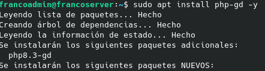
<br>
<em>Instalación de la extensión GD y reinicio de Apache para solucionar el requisito detectado.</em>
</p>

---

## 14. Nueva comprobación de prerrequisitos

Se vuelve a la interfaz de instalación de Dolibarr y se actualiza la página mediante **F5**.

La comprobación de prerrequisitos se realiza de nuevo y el error relacionado con GD ya no aparece.

<p align="center">
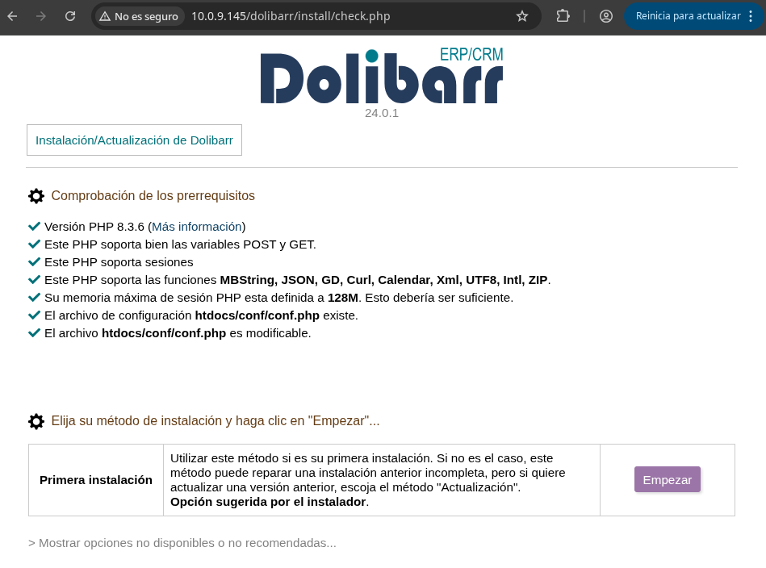
<br>
<em>Comprobación de prerrequisitos después de instalar la extensión GD.</em>
</p>

---

## 15. Configuración de la base de datos

A continuación se introducen los datos de la base de datos creada anteriormente para Dolibarr.

Los datos utilizados son:

```text
Servidor: localhost
Base de datos: dolibarr
Usuario: dolibarr
Contraseña: CONTRASEÑA
```

La contraseña se representa de forma genérica y no se incluye ninguna contraseña real en el manual.

<p align="center">
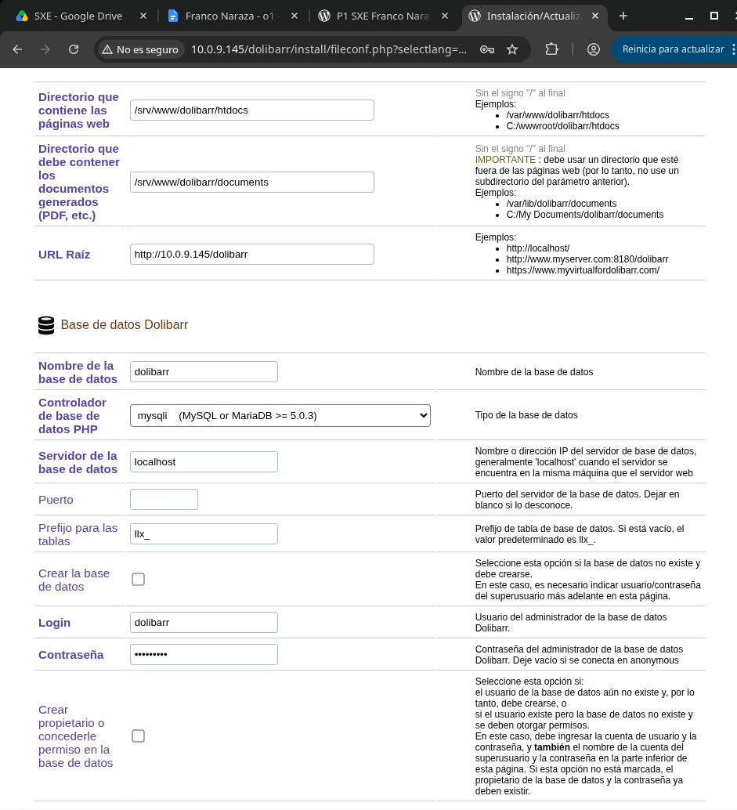
<br>
<em>Configuración de la conexión de Dolibarr con su base de datos MariaDB.</em>
</p>

---

## 16. Comprobación del archivo de configuración

Una vez configurada la conexión con la base de datos, Dolibarr genera su archivo de configuración y muestra una pantalla indicando que la configuración se ha realizado correctamente.

Se comprueba que todos los elementos necesarios aparecen correctamente configurados.

<p align="center">
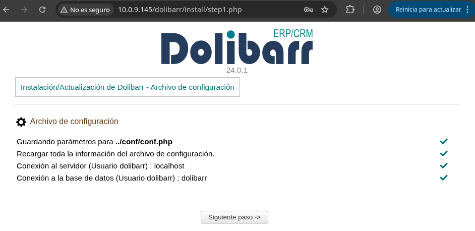
<br>
<em>Comprobación de la generación y configuración de los archivos de Dolibarr.</em>
</p>

---

## 17. Comprobación de la conexión con la base de datos

Finalmente, Dolibarr realiza una comprobación de la información de la base de datos configurada.

Todos los parámetros aparecen correctamente y la conexión se establece sin errores, confirmando que Dolibarr puede comunicarse con la base de datos `dolibarr`.

<p align="center">
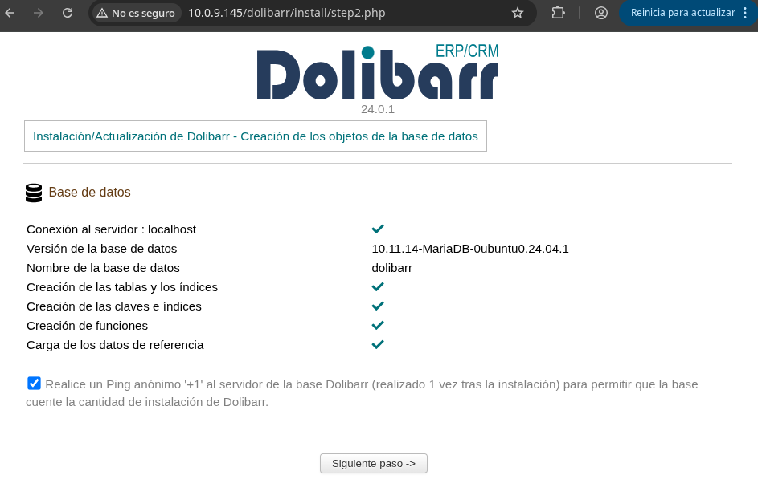
<br>
<em>Comprobación final de la información y conexión con la base de datos de Dolibarr.</em>
</p>


## 18. Wordpress y Dolibarr

Ya para terminar podemos observar como Dolibarr y Wordpress funcionan simultaneamente

<p align="center">
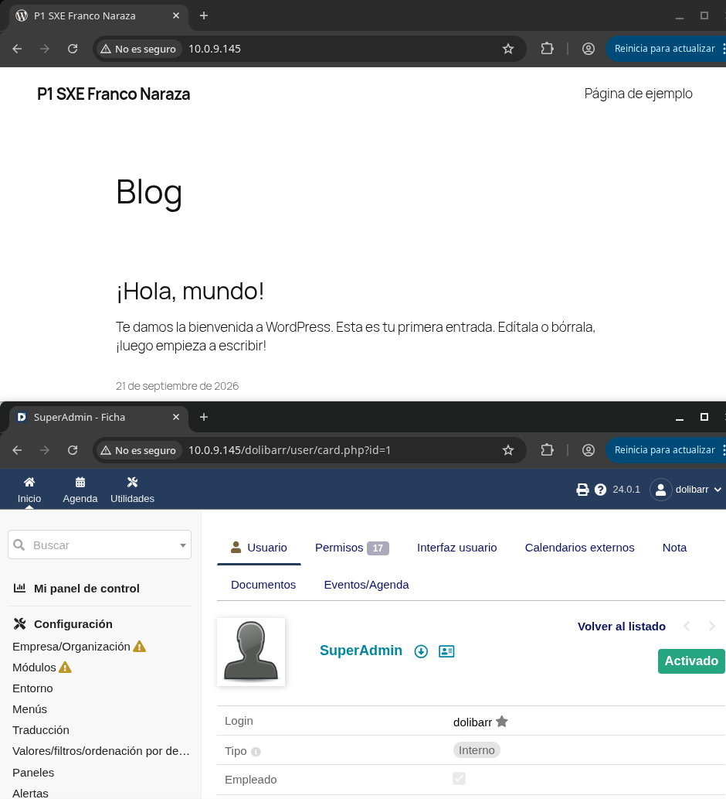
<br>
<em>Comprobación final. </em>
</p>


## Bibliografía


* [Dolibarr – Sitio oficial](https://www.dolibarr.org/)
* [Dolibarr – Documentación](https://wiki.dolibarr.org/)
* [Apache HTTP Server – Alias](https://httpd.apache.org/docs/2.4/mod/mod_alias.html)
* [PHP – Instalación y configuración](https://www.php.net/manual/es/install.php)
* [MariaDB – CREATE DATABASE](https://mariadb.com/docs/server/reference/sql-statements/data-definition/create/create-database)

### Prompt importante:

> Estoy instalando Dolibarr en un Ubuntu Server donde ya tengo WordPress funcionando con Apache, PHP y MariaDB. Durante la instalación web de Dolibarr aparece un error indicando que mi instalación de PHP no admite las funciones GD. Explícame qué significa este error, cómo puedo instalar la extensión GD en Ubuntu, qué comandos debo ejecutar para comprobar que se ha instalado correctamente y qué debo hacer después para que Apache/PHP la detecte.
